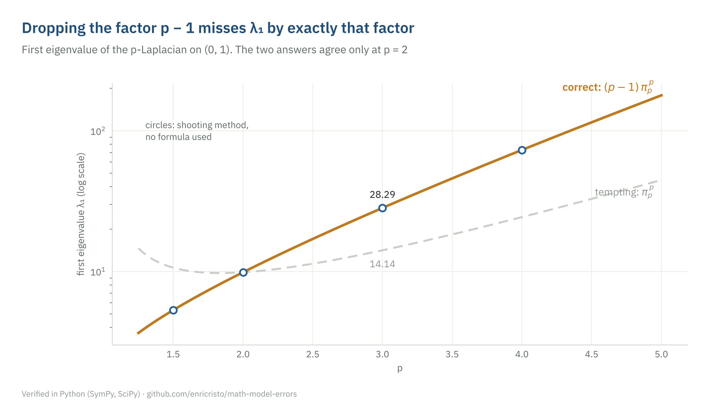
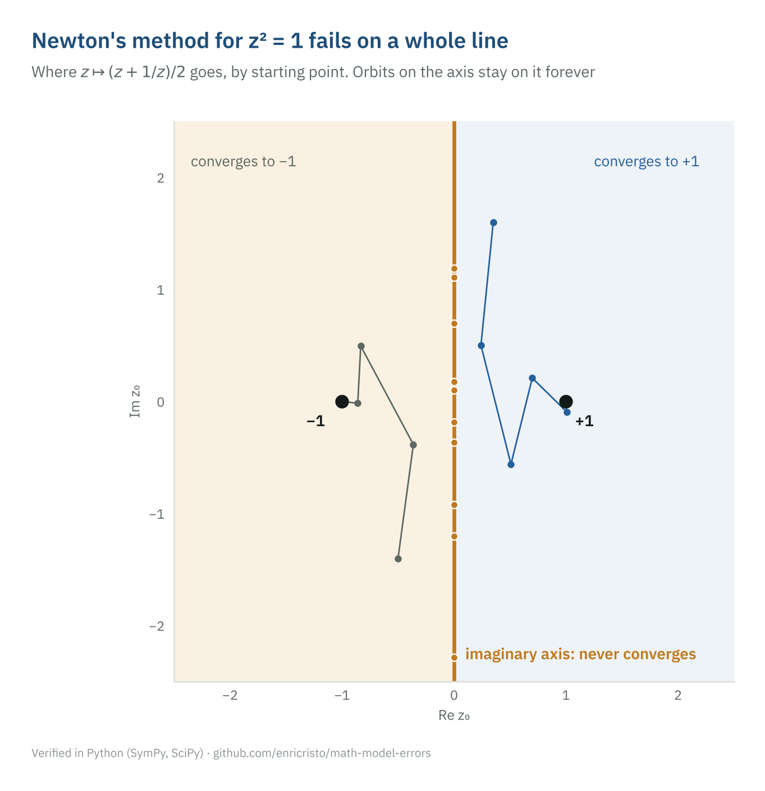
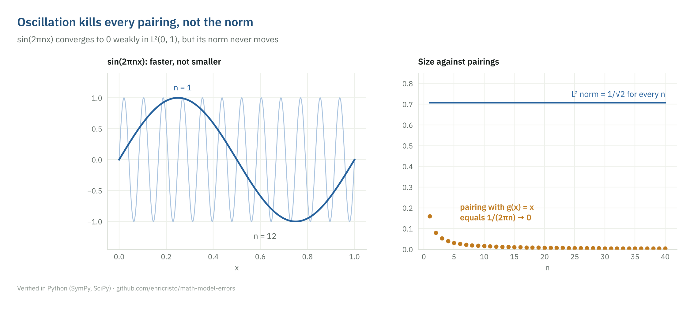
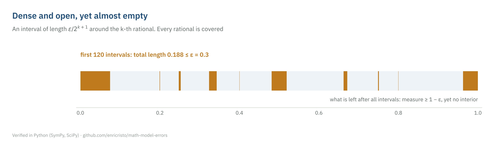

# Where math goes wrong

[](https://github.com/enricristo/math-model-errors/actions/workflows/checks.yml)

Original mathematics problems built around a trap: a tempting answer that looks
right, follows a familiar pattern, and is wrong. These are the patterns that
language models (and students) fall into: a factor that disappears outside
the classical case, a theorem applied without its hypothesis, a branch of the
logarithm taken from the wrong quadrant. Each problem comes with the tempting
answer, the reason it fails, the correct solution, and code that recomputes
every claim in SymPy or SciPy.

The problems are drawn from my own coursework in a master's in mathematics
(nonlinear analysis, functional analysis, measure theory, complex analysis,
linear algebra). Nothing here comes from the confidential material of any AI
evaluation platform. The tempting answers are written by me as typical failure
patterns; they are not transcripts of a particular model.


## Problems

| # | Problem | Area | The trap |
|---|---|---|---|
| 01 | [First eigenvalue of the p-Laplacian](problems/01-p-laplacian-first-eigenvalue.md) | nonlinear ODE | the factor p − 1 vanishes from λ₁ = (p − 1)πₚᵖ |
| 02 | [A point on the Fučík spectrum](problems/02-fucik-spectrum-point.md) | nonlinear analysis | treating a jumping nonlinearity as an eigenvalue problem |
| 03 | [Superquadratic without Ambrosetti-Rabinowitz](problems/03-superquadratic-not-ar.md) | variational methods | t ln(1 + abs(t)) grows fast, but not fast enough |
| 04 | [Newton's method for z² = 1](problems/04-newton-square-root.md) | complex dynamics | a whole line of starting points never converges |
| 05 | [Principal values of complex powers](problems/05-principal-complex-powers.md) | complex analysis | arctan(y/x) is not the argument in the left half plane |
| 06 | [Weak but not strong convergence](problems/06-weak-not-strong.md) | functional analysis | oscillation kills pairings, not norms |
| 07 | [Banach-Steinhaus needs completeness](problems/07-banach-steinhaus-completeness.md) | functional analysis | pointwise bounded on c₀₀, norms unbounded |
| 08 | [A dense open set with small measure](problems/08-small-dense-open-set.md) | measure theory | topological size is not measure |
| 09 | [The adjoint under another inner product](problems/09-adjoint-matrix.md) | linear algebra | the adjoint is the transpose only in an orthonormal basis |

### 01. Dropping a factor that is invisible at p = 2

For the p-Laplacian on (0, 1) the first eigenvalue is λ₁ = (p − 1)πₚᵖ. The
tempting answer πₚᵖ agrees with it only at p = 2, which is exactly the case
everyone has seen. A shooting method that never uses the formula lands on
the correct curve to 10⁻⁸.



### 02. Not an eigenvalue problem

With a jumping nonlinearity αu⁺ − βu⁻, positive and negative parts oscillate
at different frequencies. Solutions with one interior zero live on the curve
1/√α + 1/√β = 1, so α = 9/4 forces β = 9, far from the diagonal of
eigenvalues.


### 04. Newton's method fails on a whole line

The map z ↦ (z + 1/z)/2 becomes w ↦ w² after a Möbius change of variables.
The two half planes are the basins of ±1, and the imaginary axis, their
common boundary, is invariant: orbits there never converge.



### 06. Faster is not smaller

sin(2πnx) pairs to zero against every L² function in the limit, yet its
norm stays at 1/√2.



### 08. Dense and open, yet almost empty



## How the claims are checked

Every number and every yes/no answer in `problems/` is recomputed by
[`tests/test_problems.py`](tests/test_problems.py). The checks avoid the
formula they test whenever possible: eigenvalues and Fučík points are found
by shooting and root finding, complex powers are computed independently in
SymPy and in `cmath`, and the adjoint is checked against its defining
identity, not against a remembered formula. GitHub Actions runs the tests
on every push.

## Repository layout

| Path | Content |
|---|---|
| [`problems/`](problems/) | One file per problem: statement, tempting answer, why it fails, solution, verification |
| [`src/mme/`](src/mme/) | Verification code, one module per problem |
| [`tests/`](tests/) | Every claim in `problems/` recomputed |
| [`figures/`](figures/) | Every figure here, regenerated by `scripts/make_figures.py` |

## Running it

```bash
pip install -e ".[dev]"
pytest                          # recomputes every claim
python scripts/make_figures.py  # regenerates figures/
```

## Related

The constant πₚ of problem 01 has a formally verified closed form,
πₚ = 2π/(p sin(π/p)), in my Lean 4 repository
[lean-repo](https://github.com/enricristo/lean-repo).

## Author

Enrico Sonvenso Ambrosio · M.Sc. in Mathematics (UNESP), agronomy student
(Unoeste), researcher at LSNIA, FCT/UNESP ·
[ORCID 0000-0002-6674-3689](https://orcid.org/0000-0002-6674-3689) ·
[LinkedIn](https://www.linkedin.com/in/enricoambrosio) ·
[hilum.science](https://hilum.science/en/)

Code under the MIT License. Problem texts and figures under CC BY 4.0.
IBM Plex Sans is bundled under the SIL Open Font License
([`src/mme/fonts/OFL.txt`](src/mme/fonts/OFL.txt)).
