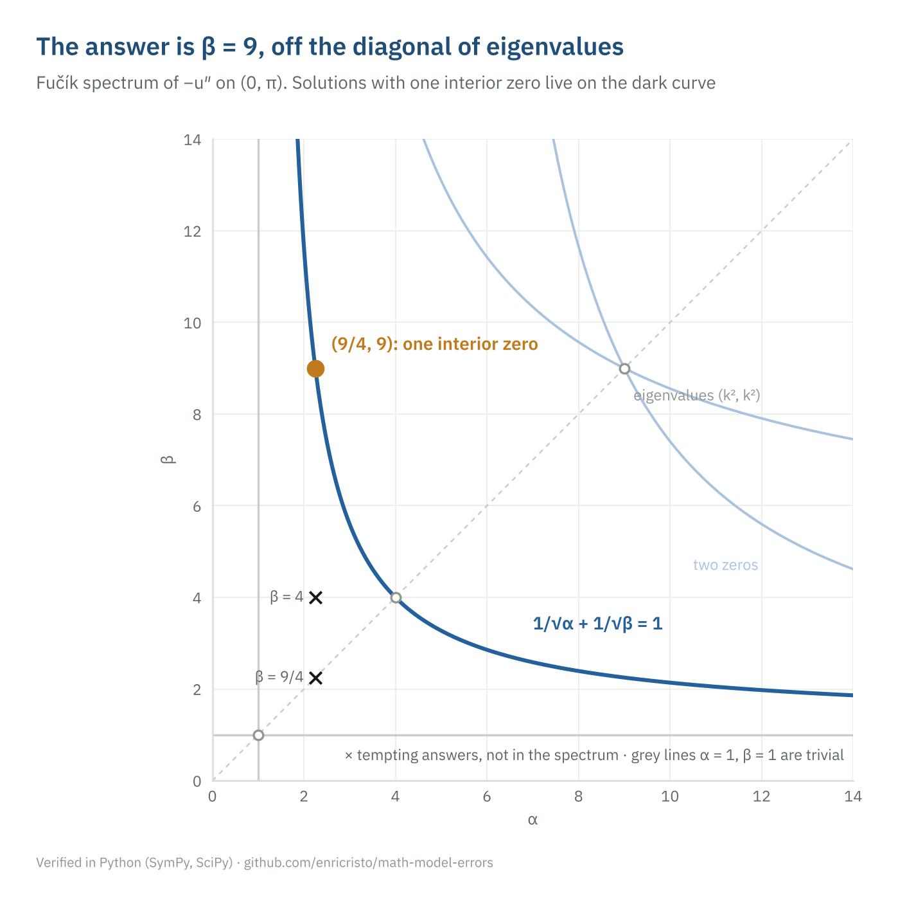

# 02 · A point on the Fučík spectrum

**Area:** nonlinear analysis, jumping nonlinearities · **Verification:** [`p02_fucik.py`](../src/mme/p02_fucik.py), shooting in SciPy · **Figure:** [`02_fucik.png`](../figures/02_fucik.png)

## Problem

For which $\beta$ does

$$-u'' = \tfrac94\,u^+ - \beta\,u^- \quad \text{on } (0, \pi), \qquad u(0) = u(\pi) = 0,$$

have a solution with exactly one zero in $(0, \pi)$? Here $u^\pm = \max(\pm u, 0)$.

## A tempting wrong answer

"This is an eigenvalue problem; a solution with one interior zero corresponds to the second eigenvalue $\lambda_2 = 4$, so $\beta = 4$" (or "$\beta = 9/4$, the same as $\alpha$").

## Why it is wrong

The equation is not linear: on the set where $u > 0$ it reads $-u'' = \frac94 u$, and where $u < 0$ it reads $-u'' = \beta u$. The two parts of the solution oscillate with different frequencies. The set of $(\alpha, \beta)$ that admit nontrivial solutions, the Fučík spectrum, is a union of curves; the eigenvalues $(\lambda_k, \lambda_k)$ are only the points of those curves on the diagonal.

## Correct solution

A solution starting positive is $\sin(\sqrt{\alpha}\,x)$ until $x = \pi/\sqrt\alpha$, then a negative half wave of length $\pi/\sqrt\beta$. It vanishes at $\pi$ with exactly one interior zero when

$$\frac{\pi}{\sqrt\alpha} + \frac{\pi}{\sqrt\beta} = \pi \iff \frac{1}{\sqrt\alpha} + \frac{1}{\sqrt\beta} = 1.$$

Starting negative gives the same curve. With $\alpha = 9/4$: $1/\sqrt\beta = 1 - 2/3$, so $\beta = 9$.

## Verification

Shooting from $u(0) = 0$, $u'(0) = 1$ with $\alpha = 9/4$, root finding on $u(\pi)$ over $\beta \in [5, 20]$ returns $\beta = 9$ to $10^{-8}$, and the solution has exactly one interior zero. For $\beta = 4$ and $\beta = 9/4$, $u(\pi)$ is far from $0$.

